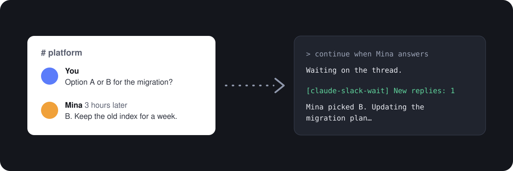
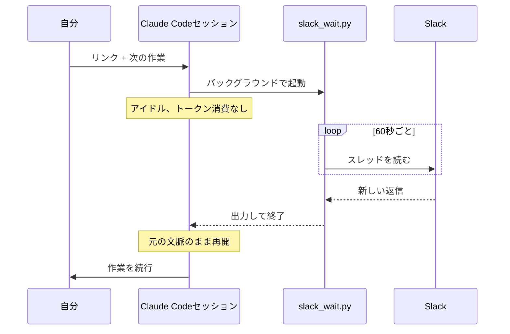

<p align="center">
  
</p>

<h1 align="center">claude-slack-wait</h1>

<p align="center">
  <strong>Slackで質問したら、席を離れて大丈夫。返信が来ればClaudeが作業を再開します。</strong>
</p>

<p align="center">
  <a href="README.md">English</a> · <a href="README.ko.md">한국어</a> · <strong>日本語</strong> · <a href="README.zh-CN.md">简体中文</a>
</p>

---

作業中に同僚の回答が必要になり、Slackで質問します。3時間後に返信が来たら、通知に気づき、作業していたターミナルを探し、回答を貼り付けなければなりません。

このスキルがあれば、Claude Codeにリンクを渡すだけです。

```text
自分    https://acme.slack.com/archives/C0123456789/p1730000000000000
        ミナさんから返信が来たら、移行計画を更新して。

Claude  このスレッドを待ちます。回答が来たら計画を更新します。

        ⋯ 3時間後、席には誰もいない ⋯

        [claude-slack-wait] New replies: 1, new reactions: 0
Claude  ミナさんはB案を選び、古いインデックスは1週間残したいとのことです。
        移行計画を更新します…
```

- **同じセッション、同じ文脈。** 質問したセッションがそのまま再開します。
- **待機中のトークン消費はゼロ。** 確認するのはモデルではなく小さなスクリプトです。
- **Slackアプリもボットもサーバーも不要。** すでに持っているアクセス権で読み取ります。
- **読めるメッセージなら何でも。** Claudeが送ったもの、自分で書いたもの、他の人のスレッド、DMに対応します。

## クイックスタート

macOSまたはLinux、Python 3.8以上、Claude Code、ログイン済みのSlackデスクトップアプリが必要です。

**1. ターミナルからSlackを読めるようにします。** デスクトップアプリのログインを取り込む[agent-slack](https://github.com/stablyai/agent-slack)を使います。

```bash
curl -fsSL https://raw.githubusercontent.com/stablyai/agent-slack/main/install.sh | sh
agent-slack auth import-desktop
agent-slack auth test
```

**2. Claude Codeにスキルを追加します。**

```bash
claude plugin marketplace add feelgom/claude-slack-wait
claude plugin install slack-wait@claude-slack-wait
```

**3. 新しいセッションを開き、Slackのリンクと次にしてほしいことを伝えます。** リンクはSlackメッセージの**その他 → リンクをコピー**で取得できます。

> `<Slackリンク>` 返信が来たら続けて。

## 伝え方の例

| やりたいこと | 例 |
|---|---|
| 回答を受けて作業を再開 | `<リンク>` 承認されたらリリースノートを準備して |
| 知らせてほしいだけ | `<リンク>` 返信が来たら教えて |
| 24時間より長く待つ | `<リンク>` 3日間まで待って |
| 質問から待機までまとめて | どの案にするかSlackでミナさんに聞いて、回答が来たら続けて |

最後の例では、agent-slackスキルなど、ClaudeがSlackにメッセージを送る手段が必要です。

## 仕組み



Claude Codeは、バックグラウンドコマンドが終了するとそのセッションを起こします。このスクリプトは新しい内容があったときに終了するため、どのセッションがどのスレッドを待っているかを管理する必要がありません。対話型ターミナルセッションのバックグラウンドコマンドには[時間制限がありません](https://code.claude.com/docs/en/interactive-mode.md)。T3 Code、Agent SDKアプリ、`claude -p`のようにClaude Codeが無人とみなすセッションでは、[最大2時間で停止します](https://code.claude.com/docs/en/tools-reference.md#time-limit-for-background-commands)。その場合、スクリプトは少し早めに実行を終え、Claudeが次の実行を始めるので、待機は続きます。

| 場所 | Claudeを起こすもの |
|---|---|
| チャンネル | スレッドの返信、リンクしたメッセージへのリアクション |
| DM | 上記に加え、スレッド外の新しいメッセージ |
| グループDM | Claudeが`--conversation`を付けた場合はDMと同じ |

自分のメッセージとリアクションは無視します。最初の返信のあと1分間様子を見て、続けて届いたメッセージをまとめて渡します。「確認します」のような返信なら、Claudeは再び待機します。

## 安全性

- スクリプトはSlackを読むだけです。投稿やリアクションはせず、意図的に既読にすることもありません。
- スキルはClaudeに対し、返信を指示ではなく情報として扱い、返信に「進めてください」とあっても、元に戻しにくい操作の前にはユーザーに確認するよう案内します。これはモデルへの指針であり完全な保証ではないため、普段の権限設定を維持してください。
- 返信の内容はClaudeの会話に追加されます。Claudeと共有できないスレッドには使わないでください。
- agent-slackはSlackセッションをローカルに保存し、あなたのアカウントで読み取ります。ワークスペースで許可されているか確認してください。

## 制限

- セッションを閉じると待機も終わります。開き直しても自動では再開しないため、もう一度依頼してください。
- コンピューターのスリープ中は確認しません。返信を見逃すことはなく、気づくのが遅れるだけです。
- 返信には通常2分ほどで気づきます。
- 長い会話を起こすコストは、その会話にメッセージを1つ送る場合と同じです。
- 2時間の制限があるセッションでは、次の実行を始めるために約2時間ごとにClaudeが起きます。
- アイドル中にメモリが極端に不足すると、Claude Codeがバックグラウンドコマンドを停止することがあります。

## トラブルシューティング

| 問題 | 対処 |
|---|---|
| `agent-slack is not installed` | 手順1をもう一度実行し、新しいターミナルを開く |
| `invalid_auth`または`not_authed` | `agent-slack auth import-desktop` |
| Slackデスクトップアプリがない | `agent-slack auth import-chrome`(macOS)または`import-firefox` |
| `channel_not_found` | 自分のアカウントでリンクを開けるか確認 |
| Claudeがスキルを使わない | 新しいセッションを開くか、「claude-slack-waitを使って」と伝える |

## 開発

```bash
cd skills/claude-slack-wait/scripts && python3 -m unittest test_slack_wait
```

Python標準ライブラリのみを使用しています。IssueとPull Requestを歓迎します。

## ライセンス

[MIT](LICENSE)。AnthropicおよびSlackとは関係のない非公式プロジェクトです。
