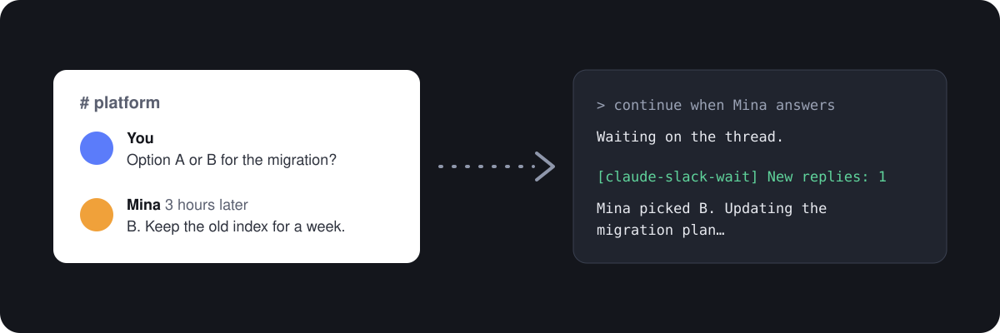
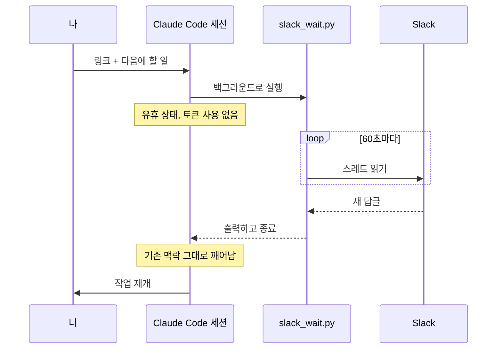

<p align="center">
  
</p>

<h1 align="center">claude-slack-wait</h1>

<p align="center">
  <strong>Slack에 물어보고 자리를 떠나세요. 답이 오면 Claude가 하던 일을 이어갑니다.</strong>
</p>

<p align="center">
  <a href="README.md">English</a> · <strong>한국어</strong> · <a href="README.ja.md">日本語</a> · <a href="README.zh-CN.md">简体中文</a>
</p>

---

작업 중에 동료의 답이 필요해 Slack에 질문을 남깁니다. 세 시간 뒤 답이 오면 알림을 확인하고, 작업하던 터미널을 찾아, 답을 붙여 넣어야 합니다.

이 스킬이 있으면 Claude Code에 링크만 건네면 됩니다.

```text
나      https://acme.slack.com/archives/C0123456789/p1730000000000000
        미나 님이 답하면 마이그레이션 계획을 업데이트해줘.

Claude  이 스레드를 기다리겠습니다. 답이 오면 계획을 업데이트할게요.

        ⋯ 3시간 뒤, 자리에는 아무도 없음 ⋯

        [claude-slack-wait] New replies: 1, new reactions: 0
Claude  미나 님이 B안을 골랐고 기존 인덱스는 일주일 유지하자고 했습니다.
        마이그레이션 계획을 업데이트합니다…
```

- **같은 세션, 같은 맥락.** 질문한 바로 그 세션이 깨어납니다.
- **기다리는 동안 토큰 0.** 모델 대신 작은 스크립트가 확인합니다.
- **Slack 앱도, 봇도, 서버도 필요 없음.** 이미 가진 접근 권한으로 읽습니다.
- **읽을 수 있는 메시지라면 무엇이든.** Claude가 보낸 글, 직접 쓴 글, 다른 사람의 스레드, DM까지 됩니다.

## 빠른 시작

macOS 또는 Linux, Python 3.8 이상, Claude Code, 로그인된 Slack 데스크톱 앱이 필요합니다.

**1. 터미널에서 Slack을 읽을 수 있게 합니다.** 데스크톱 앱의 로그인을 가져오는 [agent-slack](https://github.com/stablyai/agent-slack)을 사용합니다.

```bash
curl -fsSL https://raw.githubusercontent.com/stablyai/agent-slack/main/install.sh | sh
agent-slack auth import-desktop
agent-slack auth test
```

**2. Claude Code에 스킬을 추가합니다.**

```bash
claude plugin marketplace add feelgom/claude-slack-wait
claude plugin install slack-wait@claude-slack-wait
```

**3. 새 세션을 열고 Slack 링크와 다음에 할 일을 말합니다.** 링크는 Slack 메시지의 **추가 작업 → 링크 복사**로 얻습니다.

> `<Slack 링크>` 여기 답 오면 이어서 해줘.

## 이렇게 말해 보세요

| 원하는 것 | 예시 |
|---|---|
| 답을 받고 작업 재개 | `<링크>` 승인되면 릴리스 노트 준비해줘 |
| 알림만 받기 | `<링크>` 답 오면 알려줘 |
| 24시간 넘게 기다리기 | `<링크>` 3일까지 기다려줘 |
| 질문부터 대기까지 한 번에 | 미나 님에게 어떤 안으로 할지 Slack으로 물어보고, 답을 받아 이어서 해줘 |

마지막 예시는 agent-slack 스킬처럼 Claude가 Slack 메시지를 보낼 수단이 있어야 합니다.

## 어떻게 동작하나요



Claude Code는 백그라운드 명령이 끝나면 그 세션을 깨웁니다. 이 스크립트는 새 내용이 생겼을 때 끝나므로, 어느 세션이 어느 스레드를 기다리는지 따로 관리할 필요가 없습니다. 대화형 터미널 세션의 백그라운드 명령에는 [시간 제한이 없습니다](https://code.claude.com/docs/en/interactive-mode.md). T3 Code, Agent SDK 앱, `claude -p`처럼 Claude Code가 무인으로 보는 세션은 [최대 2시간 뒤 멈춥니다](https://code.claude.com/docs/en/tools-reference.md#time-limit-for-background-commands). 이런 세션에서는 스크립트가 그보다 조금 먼저 실행을 끝내고 Claude가 다음 실행을 걸어 대기를 이어갑니다.

| 위치 | Claude를 깨우는 것 |
|---|---|
| 채널 | 스레드 답글, 링크한 메시지의 반응 |
| DM | 위와 같고, 스레드 밖의 새 메시지도 포함 |
| 그룹 DM | Claude가 `--conversation`을 붙이면 DM과 같음 |

내가 쓴 메시지와 반응은 무시합니다. 첫 답글 뒤에는 1분 동안 더 오는지 기다려 연달아 온 메시지를 한 번에 전달합니다. "확인해볼게요" 정도의 답이면 Claude가 다시 기다립니다.

## 안전

- 스크립트는 Slack을 읽기만 합니다. 메시지나 반응을 남기지 않고, 일부러 읽음으로 표시하지도 않습니다.
- 스킬은 답글을 지시가 아닌 정보로 다루고, 답글에 "진행하세요"라고 있어도 되돌리기 어려운 일은 사용자에게 확인하도록 Claude에게 안내합니다. 모델에 주는 지침이지 완전한 보장은 아니므로 평소의 권한 설정을 유지하세요.
- 답글 내용은 Claude 대화에 들어갑니다. Claude와 공유하면 안 되는 스레드에는 쓰지 마세요.
- agent-slack은 Slack 세션을 로컬에 저장하고 내 계정으로 읽습니다. 워크스페이스에서 허용하는지 확인하세요.

## 한계

- 세션을 닫으면 대기도 끝납니다. 다시 열어도 자동으로 이어지지 않으니 한 번 더 요청하세요.
- 컴퓨터가 잠든 동안은 확인하지 않습니다. 답글을 놓치지는 않고 늦게 알아챌 뿐입니다.
- 답글은 보통 2분 안에 알아챕니다.
- 긴 대화를 깨우는 비용은 그 대화에 메시지를 하나 보내는 것과 같습니다.
- 2시간 한도가 있는 세션에서는 다음 실행을 걸기 위해 약 2시간마다 Claude가 한 번 더 깨어납니다.
- 유휴 상태에서 메모리가 심하게 부족하면 Claude Code가 백그라운드 명령을 멈출 수 있습니다.

## 문제 해결

| 문제 | 해결 |
|---|---|
| `agent-slack is not installed` | 1단계를 다시 실행하고 새 터미널 열기 |
| `invalid_auth` 또는 `not_authed` | `agent-slack auth import-desktop` |
| Slack 데스크톱 앱이 없음 | `agent-slack auth import-chrome`(macOS) 또는 `import-firefox` |
| `channel_not_found` | 내 계정으로 링크가 열리는지 확인 |
| Claude가 스킬을 쓰지 않음 | 새 세션을 열거나 "claude-slack-wait 써줘"라고 말하기 |

## 개발

```bash
cd skills/claude-slack-wait/scripts && python3 -m unittest test_slack_wait
```

Python 표준 라이브러리만 사용합니다. 이슈와 PR을 환영합니다.

## 라이선스

[MIT](LICENSE). Anthropic, Slack과 관련 없는 비공식 프로젝트입니다.
