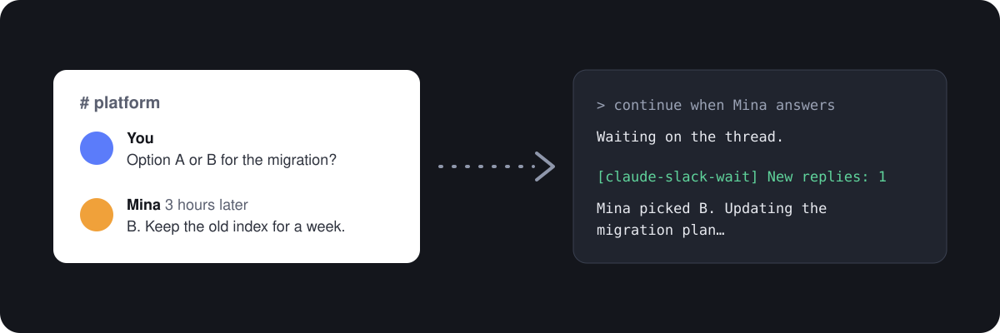
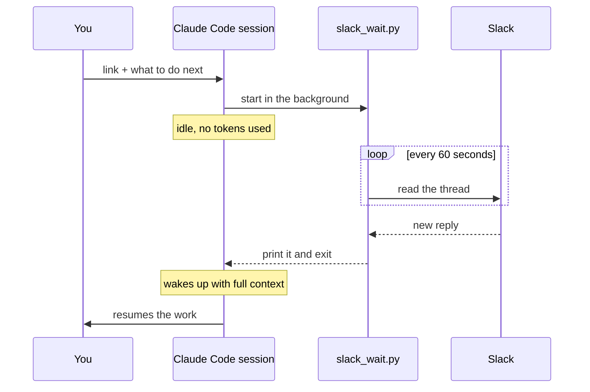

<p align="center">
  
</p>

<h1 align="center">claude-slack-wait</h1>

<p align="center">
  <strong>Ask on Slack. Walk away. Claude picks the work back up when they answer.</strong>
</p>

<p align="center">
  <strong>English</strong> · <a href="README.ko.md">한국어</a> · <a href="README.ja.md">日本語</a> · <a href="README.zh-CN.md">简体中文</a>
</p>

---

Your coding session needs an answer from a teammate, so you ask on Slack. Three hours later they reply, and you have to notice it, find the right terminal, and paste the answer in.

With this skill, you give the link to Claude Code instead:

```text
You     https://acme.slack.com/archives/C0123456789/p1730000000000000
        When Mina answers, update the migration plan.

Claude  Waiting on that thread. I'll update the plan once there is an answer.

        ⋯ 3 hours later, nobody at the keyboard ⋯

        [claude-slack-wait] New replies: 1, new reactions: 0
Claude  Mina picked option B and wants the old index kept for a week.
        Updating the migration plan…
```

- **Same session, full context.** The session that asked is the one that wakes up.
- **No tokens while waiting.** A small script does the checking, not the model.
- **No Slack app, bot or server.** It reads Slack with the access you already have.
- **Any message you can read.** Ones Claude sent, ones you typed yourself, other people's threads, and DMs.

## Quick start

You need macOS or Linux, Python 3.8+, Claude Code, and the Slack desktop app signed in.

**1. Let the terminal read Slack.** This uses [agent-slack](https://github.com/stablyai/agent-slack), which picks up your desktop login.

```bash
curl -fsSL https://raw.githubusercontent.com/stablyai/agent-slack/main/install.sh | sh
agent-slack auth import-desktop
agent-slack auth test
```

**2. Add the skill to Claude Code.**

```bash
claude plugin marketplace add feelgom/claude-slack-wait
claude plugin install slack-wait@claude-slack-wait
```

**3. Start a new session, paste a Slack link, and say what to do next.** In Slack, use **More actions → Copy link** on the message.

> `<Slack link>` Continue when they answer.

## Things to say

| You want | Say |
|---|---|
| Resume after an answer | `<link>` When they approve, prepare the release notes |
| Just be told | `<link>` Let me know when someone replies |
| Wait longer than 24 hours | `<link>` Wait up to 3 days for this |
| Ask and wait in one go | Ask Mina on Slack which option to use, then continue with the answer |

The last one needs a way for Claude to send Slack messages, such as the agent-slack skill.

## How it works



Claude Code wakes a session when one of its background commands finishes. The script finishes when there is something new, so nothing has to keep track of which session belongs to which thread. Background commands in an interactive terminal session [have no time limit](https://code.claude.com/docs/en/interactive-mode.md).

| Where | What wakes Claude |
|---|---|
| Channel | Replies in the thread, reactions on the linked message |
| DM | The same, plus new messages outside the thread |
| Group DM | Same as a DM when Claude adds `--conversation` |

Your own messages and reactions are ignored. After the first reply it waits for one quiet minute, so several messages in a row arrive together. If the answer is only "let me check", Claude goes back to waiting.

## Safety

- The script only reads Slack. It never posts, reacts or marks anything as read on purpose.
- The skill tells Claude to treat replies as information, not instructions, and to confirm with you before anything hard to undo, even if a reply says "go ahead". This is guidance to the model, not a hard guarantee, so keep your usual permission settings.
- Replies are added to your Claude conversation. Do not point it at threads you may not share with Claude.
- agent-slack stores your Slack session locally and reads with your account. Check that your workspace allows this.

## Limits

- Closing the session ends the wait. Reopening it does not restart the wait, so ask again.
- Nothing is checked while your computer sleeps. Replies are not lost, only noticed later.
- A reply is usually noticed within about two minutes.
- Waking a long conversation costs the same as sending it a message.
- Claude Code may stop background commands when an idle machine is critically low on memory.

## Troubleshooting

| Problem | Try |
|---|---|
| `agent-slack is not installed` | Run step 1 again and open a new terminal |
| `invalid_auth` or `not_authed` | `agent-slack auth import-desktop` |
| No Slack desktop app | `agent-slack auth import-chrome` (macOS) or `import-firefox` |
| `channel_not_found` | Check that your account can open the link |
| Claude does not use the skill | Start a new session, or say "use claude-slack-wait" |

## Development

```bash
cd skills/claude-slack-wait/scripts && python3 -m unittest test_slack_wait
```

Only the Python standard library is used. Issues and pull requests are welcome.

## License

[MIT](LICENSE). An unofficial project, not affiliated with Anthropic or Slack.
