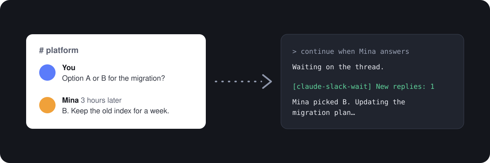
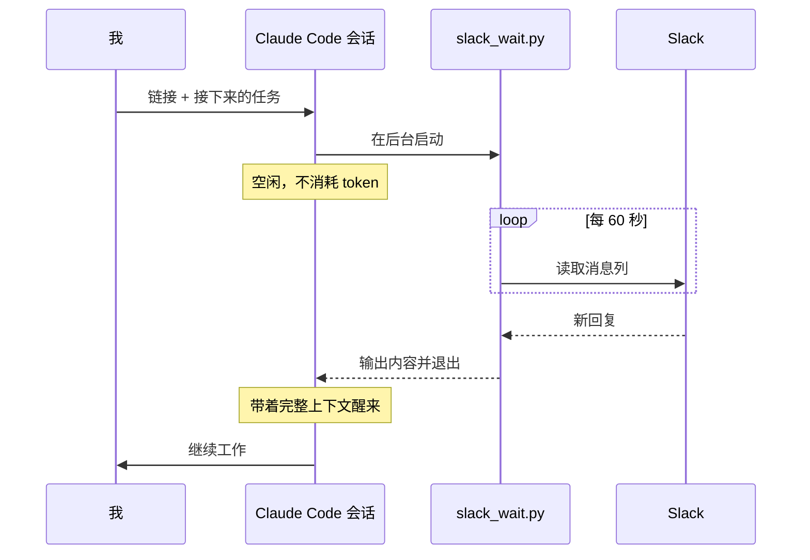

<p align="center">
  
</p>

<h1 align="center">claude-slack-wait</h1>

<p align="center">
  <strong>在 Slack 上提问，然后放心离开。对方一回复，Claude 就接着干活。</strong>
</p>

<p align="center">
  <a href="README.md">English</a> · <a href="README.ko.md">한국어</a> · <a href="README.ja.md">日本語</a> · <strong>简体中文</strong>
</p>

---

工作中需要同事给个答复，于是你在 Slack 上提问。三小时后对方回复了，你得先注意到通知，再找到当时的终端，然后把答复粘贴进去。

有了这个技能，只需把链接交给 Claude Code：

```text
我      https://acme.slack.com/archives/C0123456789/p1730000000000000
        Mina 回复后，更新迁移计划。

Claude  我会等待这个消息列，收到答复后更新计划。

        ⋯ 3 小时后，电脑前没有人 ⋯

        [claude-slack-wait] New replies: 1, new reactions: 0
Claude  Mina 选择了方案 B，并希望旧索引保留一周。
        正在更新迁移计划…
```

- **同一会话，完整上下文。** 醒来的就是当初提问的那个会话。
- **等待期间不消耗 token。** 负责检查的是一个小脚本，而不是模型。
- **无需 Slack 应用、机器人或服务器。** 使用你已有的访问权限读取。
- **只要你能读到的消息都可以。** Claude 发送的、你自己写的、别人的消息列，以及私信。

## 快速开始

需要 macOS 或 Linux、Python 3.8 及以上、Claude Code，以及已登录的 Slack 桌面应用。

**1. 让终端可以读取 Slack。** 这里使用 [agent-slack](https://github.com/stablyai/agent-slack)，它会导入桌面应用的登录状态。

```bash
curl -fsSL https://raw.githubusercontent.com/stablyai/agent-slack/main/install.sh | sh
agent-slack auth import-desktop
agent-slack auth test
```

**2. 把技能添加到 Claude Code。**

```bash
claude plugin marketplace add feelgom/claude-slack-wait
claude plugin install slack-wait@claude-slack-wait
```

**3. 打开新会话，粘贴 Slack 链接并说明接下来要做什么。** 在 Slack 消息上选择**更多操作 → 复制链接**即可获得链接。

> `<Slack 链接>` 等对方回复后继续。

## 可以这样说

| 你想要 | 示例 |
|---|---|
| 收到答复后继续工作 | `<链接>` 批准后准备发布说明 |
| 只想收到提醒 | `<链接>` 有人回复就告诉我 |
| 等待超过 24 小时 | `<链接>` 最多等 3 天 |
| 提问并等待一步完成 | 在 Slack 上问 Mina 用哪个方案，收到答复后继续 |

最后一种用法需要 Claude 能够发送 Slack 消息，例如安装 agent-slack 技能。

## 工作原理



后台命令结束时，Claude Code 会唤醒所属的会话。脚本在出现新内容时结束，因此无需记录哪个会话在等待哪个消息列。交互式终端会话中的后台命令[没有时间限制](https://code.claude.com/docs/en/interactive-mode.md)。在 T3 Code、Agent SDK 应用、`claude -p` 等被 Claude Code 视为无人值守的会话中，后台命令[最多运行 2 小时](https://code.claude.com/docs/en/tools-reference.md#time-limit-for-background-commands)。此时脚本会提前一点结束本次运行，由 Claude 启动下一次，等待得以继续。

| 位置 | 什么会唤醒 Claude |
|---|---|
| 频道 | 消息列中的回复、对所链接消息的表情回应 |
| 私信 | 同上，另外包括消息列之外的新消息 |
| 群组私信 | Claude 加上 `--conversation` 时与私信相同 |

你自己的消息和表情回应会被忽略。收到第一条回复后会再观察一分钟，把连续的消息一起交给 Claude。如果答复只是“我看一下”，Claude 会继续等待。

## 安全

- 脚本只读取 Slack，不会发送消息或添加表情回应，也不会主动标记为已读。
- 技能会指示 Claude 把回复当作信息而不是指令；即使回复写着“可以执行”，在进行难以撤销的操作前也要向你确认。这是给模型的指引，并非绝对保证，请保留你平时的权限设置。
- 回复内容会进入你的 Claude 对话。请不要用于不能与 Claude 共享的消息列。
- agent-slack 会在本地保存你的 Slack 会话，并以你的账号读取。请确认你的工作区允许这样做。

## 限制

- 关闭会话后等待也会结束。重新打开不会自动恢复，需要再次提出。
- 电脑休眠期间不会检查。回复不会丢失，只是会晚一些发现。
- 通常在两分钟左右发现回复。
- 唤醒一个很长的对话，成本与向该对话发送一条消息相同。
- 在有 2 小时限制的会话中，Claude 还会大约每 2 小时醒来一次，启动下一次运行。
- 空闲时如果内存严重不足，Claude Code 可能会停止后台命令。

## 故障排除

| 问题 | 解决办法 |
|---|---|
| `agent-slack is not installed` | 重新执行第 1 步并打开新终端 |
| `invalid_auth` 或 `not_authed` | `agent-slack auth import-desktop` |
| 没有 Slack 桌面应用 | `agent-slack auth import-chrome`（macOS）或 `import-firefox` |
| `channel_not_found` | 确认你的账号可以打开该链接 |
| Claude 没有使用该技能 | 打开新会话，或直接说“使用 claude-slack-wait” |

## 开发

```bash
cd skills/claude-slack-wait/scripts && python3 -m unittest test_slack_wait
```

仅使用 Python 标准库。欢迎提交 Issue 和 Pull Request。

## 许可证

[MIT](LICENSE)。本项目为非官方项目，与 Anthropic 和 Slack 无关。
